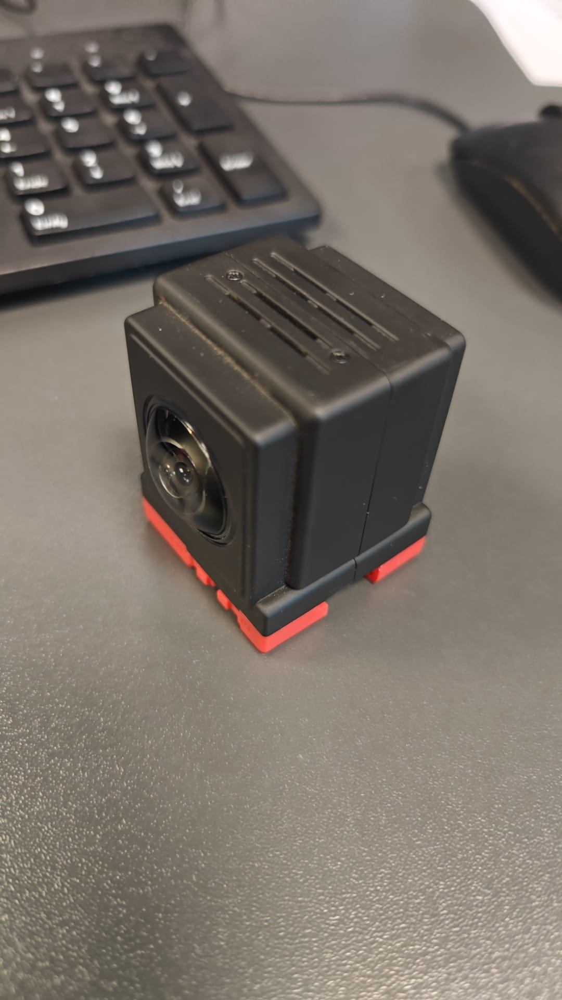

# BetaFPV SMO 360 (serial IBEEN2107YHYG3): calibration and camera data



Everything needed to work metrically with **this** camera, serial number **IBEEN2107YHYG3**: VIO, structure from
motion, Gaussian splatting. As of 2026-11-20, project OCTOPUS (Westfälische Hochschule, wiki page of the
"wissenschaftliche Vertiefung OCTOPUS"). The calibration is valid for this unit only; another SMO 360 has to be
calibrated again.

## Folders

| Folder | Content |
|---|---|
| `01_calibration/` | **The final files you use** (see below) |
| `02_configs/` | configs derived from them for OpenVINS (960 px) and TagSLAM (2880 px) |
| `03_imu_noise/` | measured IMU noise values and Allan deviation plot |
| `04_calibration_derivation/` | how the calibration was made (`README.md`, every intermediate step, validation) |

## The final files (`01_calibration/`)

| File | Content |
|---|---|
| `betafpv_smo_360_calibration.json` | **Main file** (Basalt format): both lenses (Kannala-Brandt KB4), lens poses relative to the IMU, camera-IMU time offset, IMU noise and bias |
| `betafpv_smo_360_mask.png` | **Lens mask**, 2880 × 2880, greyscale, 255 = use the pixel. Drawn by hand (Photocraft), valid for both lenses |
| `betafpv_smo_360_rolling_shutter.json` | **Rolling shutter**: readout time per lens (Kalibr), rows top to bottom |
| `aprilgrid_6x6.json` | Calibration target: AprilGrid 6 × 6, tag 88 mm, spacing 0.3 (measured on the print) |

`spirula metric360` finds the mask and the rolling-shutter file on its own when they lie next to the calibration
with matching names (`<name>_mask.png`, `<name>_rolling_shutter.json`).

## Key facts about the camera

* Internally an **Insta360 ONE R** (360 module); it reports itself as such in the file metadata. Firmware v10.1.26.
* Two fisheye lenses, **2880 × 2880 px** each, **30 fps**, mounted back to back (rotated 180° against each other), 3.8 cm apart.
  Field of view per lens: the image edge is at ~96° from the optical axis.
* Every recording consists of **two files**, `…_00_….insv` and `…_10_….insv`, one per lens.
  * **cam0 = `_10_` file** (looks along IMU +x), **cam1 = `_00_` file** (looks along IMU −x).
  * The IMU data is stored in the `_00_` file.
* **IMU:** TDK ICM-20948, **500 Hz**, gyroscope and accelerometer. Read it with `telemetry-parser`
  (Python binding, see `Dataset-IMU-Video/insv_imu_viz/extract_imu.py`).
* **Time offset** camera → IMU: −9.5 ms (Basalt convention, relative to the container timestamp of the video frames).
* **Rolling shutter:** 22.18 ms (cam0) and 22.22 ms (cam1) for 2880 rows, top to bottom.
  The factory value in the metadata (23.516 ms for 3040 sensor rows) converts to 22.28 ms, so it agrees.
* **Data rate** ~0.34 GB per minute per lens file. Recordings end after about **30 min** (segment limit or overheating).

## Pitfalls

1. **Pick the IMU noise to match the recording.** The values in the calibration are static values (Allan deviation) and too optimistic:
   * **Handheld (no vibration):** static values × 5 (`02_configs/openvins_960px/kalibr_imu_chain_handheld.yaml`).
   * **Flight with propellers:** vibration makes the noise much larger (`kalibr_imu_chain_flight.yaml`, ~25 × static).
     These flight values are **not a calibration**: an Allan analysis needs the camera at rest, and none was done in
     flight. They were estimated from the vibration spectrum (Welch, 5–30 Hz) of the IMU in an ordinary flight
     recording (`VID_20240320_184240`) and are only confirmed by OpenVINS running stably on flights.
   * **Basalt (both lenses), handheld:** static × 5 is unstable in Basalt. Accel 0.015 / gyro 0.0009 (tuned on the tag
     recording 010) gave a scale error of −5.7 %; the flight values gave −15 %.
   * **Never use the flight values on handheld recordings:** the IMU becomes almost useless for scale (scale error +69 % instead of +4 %).
2. **Mask out the lens edge.** Beyond ~80° from the image centre the reprojection error grows. Mask below 90° for VIO
   and TagSLAM (VIO: 70–85°); use the lens mask for splat training.
3. **Exposure time changes.** Usually 8.3 ms, up to 33 ms in the dark (4 × more motion blur). It is stored per frame
   in the metadata (`Exposure`).
4. **Warm-up.** For the first 12–15 min after switching on, the gyro and accel biases drift. VIO estimates the bias
   online; for static measurements, wait.
5. **Do not work with stitched 360° images** (Insta360 Studio / MediaSDK) when accuracy matters: the lens calibration
   is lost. Use the raw fisheye images of both lenses instead.
6. **Basalt with both lenses** needs our patch for non-overlapping cameras
   (`Dataset-IMU-Video/metric360-docker/basalt-patches/`); stock Basalt effectively uses one lens only.

## Accuracy (verified)

* Camera-IMU calibration: mean reprojection error 0.78 px, gravity 9.798 m/s².
* Against an AprilTag ground truth (TagSLAM, 60 tags): VIO scale within ~4 %, metric splat with bundle adjustment
  within ~1 % (details: `04_calibration_derivation/validation/` and the project wiki).

## Usage

Metric splat from one recording (Spirula Studio, also inside the Docker image `metric360`):
```bash
spirula metric360 /path/VID_…_00_….insv --calib 01_calibration/betafpv_smo_360_calibration.json --out /path/output --train
```
or through Docker (the calibration is built in):
```bash
Dataset-IMU-Video/metric360-docker/spirula-docker metric360 /path/VID_…_00_….insv --out /path/output --train
```
Both `.insv` files of a recording must lie in the same folder. Use absolute paths.

Note (2026-11-20): the Docker image does not contain COLMAP yet, so the default (fisheye) mode does not run there.
Until it does, work locally with Spirula and an installed COLMAP, or use `--mode equirect` in Docker.

## Recalibrating

Steps, commands and pitfalls are in `04_calibration_derivation/README.md`; in short:
1. Lenses: `basalt_calibrate_cam` on recordings in front of the AprilGrid (both lenses).
2. IMU noise: `basalt_calibrate_imu` on a static recording (as long as possible, max. ~30 min; do not use the first 15 min of warm-up).
3. Camera-IMU: `basalt_calibrate_vi` on a handheld recording in front of the grid, **without** `opt_imu_scale`
   (otherwise scale and gravity trade off; rejected run: scale 0.727, g = 7.11 m/s²).
4. Rolling shutter: Kalibr (`Dataset-IMU-Video/vio_work/rs_calib_012/run.sh`), intrinsics fixed to step 1.

Raw calibration data: the camera-IMU recording in `Dataset-IMU-Video/cam_imu_calibration_data/`; the bags and the
static IMU recording on the external drive `EDDF-B044` (`basalt_calib/`).
